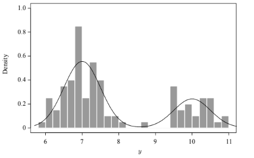

# Independence Chains

## 1. Algoritmo de Metropolis–Hastings

Sea $\pi(x)$ una densidad objetivo conocida salvo una constante de normalización. En cada iteración, desde el estado actual $x^{(t)}$:

1. Genera un candidato $x^* \sim q(\cdot \mid x^{(t)})$.
2. Calcula la razón de aceptación:

$$
r(x^{(t)},x^*) = \frac{\pi(x^*)\,q(x^{(t)}\mid x^*)}{\pi(x^{(t)})\,q(x^*\mid x^{(t)})}.
$$

1. Acepta el candidato con probabilidad $\alpha = \min(1,r)$. Si lo rechaza, conserva el estado actual.

La constante desconocida de $\pi$ se cancela en la razón.

## 2. Cadenas de independencia

En una cadena de independencia, la propuesta no depende del estado actual:

$$
q(x^* \mid x^{(t)}) = g(x^*).
$$

Por tanto, la razón de aceptación es:

$$
r(x^{(t)},x^*) = \frac{\pi(x^*)\,g(x^{(t)})}{\pi(x^{(t)})\,g(x^*)}.
$$

Si definimos el peso de importancia $w(x)=\pi(x)/g(x)$, entonces $r=w(x^*)/w(x^{(t)})$. Una propuesta útil debe parecerse a la distribución objetivo y cubrir su soporte. Si la cadena está en un estado con peso alto y la propuesta rara vez visita regiones relevantes de $\pi$, puede quedarse estancada durante mucho tiempo.

La condición $g(x)>0$ donde $\pi(x)>0$ es necesaria para explorar la distribución objetivo, pero no garantiza buena mezcla en una corrida finita.

## 3. Ejemplo bayesiano: mezcla de dos normales

Se observan $y_1,\dots,y_n$ de una mezcla con parámetro $\delta$:

$$
y_i \mid \delta \sim \delta\,\mathcal{N}(7,0.5^2)+(1-\delta)\,\mathcal{N}(10,0.5^2), \qquad 0<\delta<1.
$$

Usamos la priori $\delta\sim\text{Unif}(0,1)$. La posteriori, salvo una constante de normalización, es:

$$
\pi(\delta\mid y) \propto \prod_{i=1}^{n}\left[\delta\,\phi(y_i;7,0.5^2)+(1-\delta)\,\phi(y_i;10,0.5^2)\right].
$$

El ejemplo ilustrado usa 100 observaciones generadas con $\delta=0.7$.

### Usar la priori como propuesta

Si la propuesta es la priori uniforme, $g(\delta)=1$ en $(0,1)$, la razón de aceptación queda como una razón de verosimilitudes:

$$
r(\delta^{(t)},\delta^*) = \frac{L(\delta^*\mid y)}{L(\delta^{(t)}\mid y)}.
$$

### Comparación de propuestas independientes

| Propuesta | Comportamiento en este ejemplo |
| --- | --- |
| $\text{Beta}(1,1)$ | Es uniforme y cubre la región posterior relevante; en el ejemplo explora el espacio con rapidez. |
| $\text{Beta}(2,10)$ | Se concentra en valores pequeños y casi no propone cerca de $\delta\approx0.7$; puede producir largos periodos de estancamiento. |

Aunque ambas propuestas tienen soporte en $(0,1)$, su desempeño práctico puede ser distinto. Las trayectorias ilustran la diferencia:

En el ejemplo se descartaron las primeras 200 iteraciones como calentamiento (*burn-in*). Los histogramas posteriores muestran que la propuesta uniforme representa mejor la distribución objetivo. El calentamiento no corrige por sí solo una propuesta deficiente ni demuestra convergencia.

## 4. Cadenas de caminata aleatoria

En una caminata aleatoria, el candidato se obtiene perturbando el estado actual:

$$
X^* = X^{(t)} + \epsilon, \qquad \epsilon\sim h.
$$

Son opciones comunes $\epsilon\sim\text{Unif}(-a,a)$ y $\epsilon\sim\mathcal{N}(0,\sigma^2)$. Si $h$ es simétrica alrededor de cero, la razón de aceptación se simplifica a:

$$
r(x^{(t)},x^*)=\frac{\pi(x^*)}{\pi(x^{(t)})}.
$$

La propuesta puede aceptar movimientos hacia regiones de menor densidad, lo cual permite explorar la distribución.

## 5. Restricciones y transformación logit

Como $\delta$ debe permanecer en $(0,1)$, una caminata directa puede proponer valores fuera del soporte. La transformación logit permite proponer en toda la recta real:

$$
u=\text{logit}(\delta)=\log\left(\frac{\delta}{1-\delta}\right), \qquad
\delta=\text{logit}^{-1}(u)=\frac{1}{1+e^{-u}}.
$$

Se propone $u^*=u^{(t)}+\epsilon$. La densidad objetivo transformada incluye el Jacobiano:

$$
\pi_u(u\mid y)=\pi_\delta(\text{logit}^{-1}(u)\mid y)\,\delta(1-\delta).
$$

Para una propuesta simétrica en el espacio $u$, la razón de aceptación es:

$$
r(u^{(t)},u^*) = \frac{\pi_\delta(\delta^*\mid y)\,\delta^*(1-\delta^*)}{\pi_\delta(\delta^{(t)}\mid y)\,\delta^{(t)}(1-\delta^{(t)})}.
$$

La figura muestra trayectorias de una caminata aleatoria después de transformar el parámetro:

## 6. Escala de la propuesta y diagnóstico

- **Pasos muy pequeños:** suelen aceptarse, pero la cadena se desplaza lentamente.
- **Pasos muy grandes:** suelen rechazarse, y la cadena puede repetir el mismo estado muchas veces.
- **Escala razonable:** equilibra desplazamiento y aceptación; depende de la dimensión y de la distribución, así que no hay una tasa óptima universal.

Evalúa las trayectorias, la autocorrelación y el tamaño efectivo de muestra. Ni un histograma ni la tasa de aceptación, por sí solos, demuestran convergencia.
